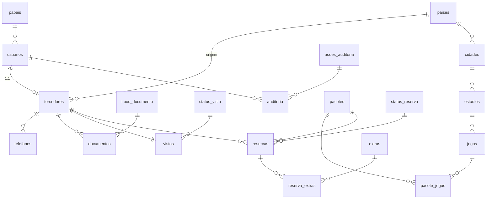

# BorderKick — Logística de Fronteiras para Torcedores (Copa 2026)

Node.js + Express + **MySQL**. O mesmo servidor entrega as páginas (`public/`) e a API (`/api`).

## 1. Rodar no seu computador
Requisitos: Node 18+ e MySQL (ou MariaDB/XAMPP) ligado.
```
npm install
copy .env.example .env      (Mac/Linux: cp .env.example .env)   ← edite DB_USER / DB_PASSWORD
npm start                   → http://localhost:3000
```
O servidor **cria o banco `borderkick`, as tabelas, os dados de domínio e os pacotes** sozinho na primeira execução.
O servidor lê o arquivo `.env` automaticamente (renomeie/copie o `.env.example` para `.env`).
Alternativa manual: importe `database/borderkick_completo.sql` no Workbench/phpMyAdmin.
Atendente padrão: **atendente@borderkick.com / Atendente@123** (mude com `ATENDENTE_SENHA`).

## 2. Banco de dados — 3ª Forma Normal
Diagrama e regras (20 tabelas):

- **1FN (atomicidade):** nome e sobrenome separados; telefone em DDD + número (tabela própria, permite vários); CPF só dígitos (CHECK); data como `DATE`; extras de uma reserva em tabela própria (nada de listas/JSON em coluna); auditoria sem texto livre (colunas com chaves estrangeiras).
- **2FN:** tabelas de associação (`pacote_jogos`, `reserva_extras`) têm chave composta e só atributos que dependem da chave inteira.
- **3FN (sem dependência transitiva):** tudo que é domínio virou tabela própria — `papeis`, `paises`, `cidades`→`estadios`→`jogos` (jogo não repete cidade/país), `tipos_documento`, `status_visto`, `status_reserva`, `acoes_auditoria`. O **total** da reserva não é guardado: é calculado.
- **Decisão consciente:** `reservas.preco_pacote` e `reserva_extras.preco_unitario` guardam o preço *no momento da compra* (histórico). Não é redundância: se o preço do pacote mudar depois, vouchers antigos não podem mudar. É o padrão em sistemas de venda.
- Integridade: chaves estrangeiras, `UNIQUE` (e-mail, CPF, código), `CHECK` (CPF, telefone, preços), `InnoDB`, `utf8mb4`.

## 3. Regra de negócio (3 camadas)
1. **Servidor:** `POST /api/reservas` recusa (403) pacote com jogo nos EUA se o visto não for "Aprovado e Validado"; a tentativa fica na auditoria.
2. **Banco:** *trigger* `trg_reservas_exige_visto` bloqueia o `INSERT` mesmo que alguém fale direto com o banco (se o seu MySQL não permitir criar triggers, o servidor avisa no console e a regra continua valendo nas camadas 1 e 3).
3. **Voucher:** ao abrir, a regra é conferida de novo; visto revogado depois → voucher **suspenso**, sem código.
Também: só atendente altera o visto; aprovar exige o documento do visto enviado; reenviar visto volta para "Em análise"; rejeitar exige motivo.

## 4. Hospedagem gratuita
O site precisa de um servidor Node **e** de um MySQL; o GitHub Pages sozinho não serve (só arquivos estáticos).
- **Aplicação:** Render (plano Free) — repositório GitHub → New Web Service → Build `npm install`, Start `npm start`.
- **MySQL grátis:** Aiven (plano Free: 1 GB, 1 vCPU, sem cartão; pode desligar por inatividade, e você religa no painel). Crie o serviço MySQL e copie host, porta, usuário, senha.
- **Variáveis no Render:** `NODE_ENV=production`, `NODE_VERSION=20`, `JWT_SECRET`, `ATENDENTE_EMAIL`, `ATENDENTE_SENHA`, `DB_HOST`, `DB_PORT`, `DB_USER`, `DB_PASSWORD`, `DB_NAME` (ex.: `defaultdb`, o banco que o Aiven já cria) e `DB_SSL=true`.
- Limites: o disco do Render Free é temporário → **arquivos enviados (documentos) somem a cada reinício** (os registros no MySQL permanecem). Para a apresentação, faça o cadastro de teste pouco antes. O app dorme após ~15 min parado (1º acesso ~50 s).

## 5. Apresentação na máquina local
Instale Node + MySQL (+ Workbench) na máquina da apresentação **com antecedência**, extraia o zip, crie o `.env`, rode `npm install` e `npm start`.
Para mostrar o banco ao vivo, abra `database/demo_consultas.sql` no Workbench e rode as consultas uma a uma
(torcedores, dados atômicos, pacotes, vouchers, auditoria e o teste da trigger que bloqueia a venda direto no banco).
